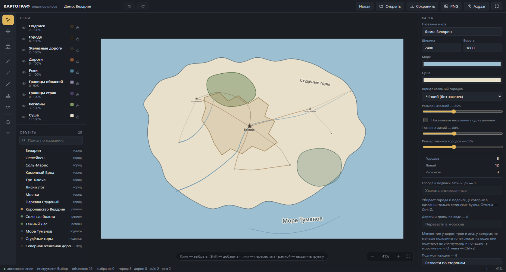

# Картограф — редактор мировых карт для D&D

Не генератор: карта рисуется руками. Города, дороги, железные дороги, реки,
регионы-заливки, подписи. Плюс импорт уже сгенерированных карт из
[Azgaar Fantasy Map Generator](https://azgaar.github.io/Fantasy-Map-Generator/).



## Запуск

```bash
npm install
npm run dev        # http://127.0.0.1:5178
```

Проверки:

```bash
npm run typecheck
npm test
npm run build
```

## Что умеет

- **Карта** — бесконечное море, суша полигонами, панорамирование и зум колесом.
- **Кисти** — суша и вода: тянешь мышью, мазки ложатся поверх импортированной суши,
  поэтому вода закрашивает и чужой берег. Радиус регулируется, штрих отменяется целиком.
- **Города** — 5 типов (столица, город, городок, деревня, точка интереса),
  перетаскивание, размеры, подписи с обводкой. Подпись ставится снизу, сверху,
  слева или справа от значка — по одному городу или сразу для всех кнопкой
  «Развести по сторонам». Шрифт подписей переключается в свойствах карты:
  «чёткий» (без засечек) или «книжный» (с засечками), там же ползунок общего
  размера названий (по умолчанию 80%) и галочка «показывать население».
- **Линии** — дороги, железные дороги (со шпалами), морские пути
  (штрих-пунктир), реки с сужением к истоку. Концы линий цепляются к городам.
  Общая толщина регулируется ползунком в свойствах карты (по умолчанию 80%),
  там же размер значков городов (85%); на мелком масштабе линии дополнительно
  утоньшаются, чтобы карта не слипалась.
- **Регионы** — замкнутые контуры с полупрозрачной заливкой; обводка держит
  минимальную толщину на экране, поэтому не пропадает при отдалении.
- **Границы** — два отдельных типа и слоя: границы стран (сплошная тёмная линия)
  и границы областей (тонкий пунктир). Включаются и выключаются независимо.
- **Подписи** — свободный текст с кеглем и поворотом.
- **Слои** — видимость, блокировка, прозрачность.
- **Правка формы** — перетаскивание вершин у линий и регионов. Линию можно
  укоротить по одной точке: кнопки «− с начала» и «− с конца» в карточке линии,
  а `Alt`+клик по любой точке убирает именно её.
- **Свойства** — панель справа: тип, размеры, цвета, заметки для ДМ.
- **История** — undo/redo, быстрые правки поля склеиваются в один шаг.
- **Файлы** — автосохранение в браузере, проект `.dndmap` (JSON), экспорт PNG.
- **Импорт Azgaar** — `.map` превращается в редактируемую карту: суша, границы
  государств, реки, города, дороги.

## Массовые правки

В правой панели (когда ничего не выделено) есть кнопки, которые правят карту
целиком и откатываются одним `Ctrl+Z`:

- **Удалить англоязычные** — убирает города и подписи, названные латиницей;
- **Перевести в морские** — дороги, идущие по воде, становятся морскими путями;
- **Развести по сторонам** — расставляет подписи городов, чтобы они не наезжали.

## Горячие клавиши

Сочетания привязаны к физическим клавишам, а не к символам, поэтому работают
и на русской раскладке (`Ctrl+Z` = `Ctrl+Я`). Внутри поля ввода `Ctrl+Z`, наоборот,
отменяет ввод текста — это стандартное поведение браузера.

| Клавиша | Действие |
| --- | --- |
| `V` / `1` | выбор |
| `H` / `2` | прокрутка |
| `C` / `3` | город |
| `R` / `4` | дорога |
| `X` / `5` | железная дорога |
| `S` | морской путь |
| `W` / `6` | река |
| `G` / `7` | регион |
| `L` / `8` | подпись |
| `B` | кисть суши |
| `N` | кисть воды |
| `Enter` | закончить линию / замкнуть регион |
| `Esc` | отменить рисование / снять выделение |
| `Delete` | удалить выделенное |
| `Ctrl+Z` / `Ctrl+Shift+Z` | отменить / повторить |
| `Ctrl+D` | дублировать |
| `Ctrl+S` | сохранить проект |
| `+` / `-` / `0` | зум / вписать карту |
| `Пробел` + тянуть | панорама |

## Импорт из Azgaar

Файл `.map` у Azgaar — не цельный JSON, а «секции по строке»: заголовок с версией,
затем отдельными строками биомы, SVG всей карты, государства, города, маршруты,
маркеры. Геометрии суши в данных нет — только в SVG (`featurePaths`), поэтому
контуры разбираются из SVG, а справочники берутся из JSON-секций.

Что попадает в редактор:

| Что | Откуда |
| --- | --- |
| Суша и озёра | `featurePaths` из SVG, вложенность контуров отличает остров от озера |
| Границы государств | группы `stateBorders` / `provinceBorders` (пунктирные линии) |
| Реки | группа `rivers` из SVG; толщина и название — из списка рек |
| Дороги и морские пути | секция `routes` (`searoutes` → морской путь, `trails` → дорога) |
| Города | секция `burgs`, тип по населению и `capital`; население переносится в человека́х |
| Названия государств | секция `states`, якорь подписи `pole` |
| Метки (руины, данжи…) | секция `markers`, только именованные |

Проверено на файлах версий **1.108** и **1.154**. Формат менялся: в 1.154 секции
разделены пустой строкой, в 1.108 идут подряд, а пустые группы записаны
самозакрывающимися `<g .../>`. Оба варианта разбираются, на оба есть тесты.

Чего в файле может не быть:

- **реки** сохраняются только если слой рек был включён при сохранении — иначе
  в файле остаётся список рек без координат, и импорт честно пишет об этом;
- заливок государств нет, только границы;
- биомы, рельеф и текстуры не переносятся — это визуал Azgaar, а не редактируемая
  геометрия.

Геометрия упрощается по Дугласу—Пекеру: карта на 4.8 МБ ужимается с 315 тысяч
точек до ~10 тысяч без видимой потери качества.

Старый формат (цельный JSON с `pack.cells`) тоже поддерживается — см.
`src/core/azgaarLegacy.ts`.

## Устройство

```
src/core/    модель документа, геометрия, камера, рендер на Canvas 2D, стор, импорт
src/ui/      React-панели и холст
src/dev/     отладочные страницы (не входят в сборку)
src/test/    заглушка localStorage для тестов
```

Документ — плоский список объектов в мировых координатах. Слой объекта выводится
из его типа (`layerOf`), поэтому порядок отрисовки всегда стабилен: суша → регионы
→ реки → дороги → ж/д → города → подписи.

## Отладочные страницы

На dev-сервере доступны:

- `/import-check.html` — импортирует `.map` и рисует результат тем же рендерером,
  печатает отчёт и тайминги;
- `/interaction-check.html` — монтирует настоящее приложение и прогоняет сценарии
  мышью: постановка города, дорога, перетаскивание, undo, Esc, Delete, экспорт PNG.

Быстрая загрузка карты в редактор: `/?import=/dev-sample.map` (только в dev-режиме).
Размеры холста и зум в углу: `/?debug` (тоже только в dev-режиме).

